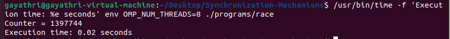
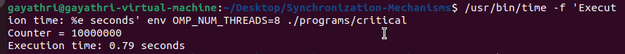
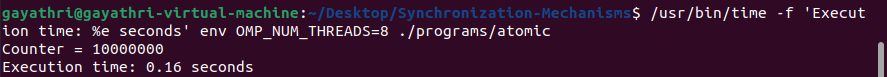
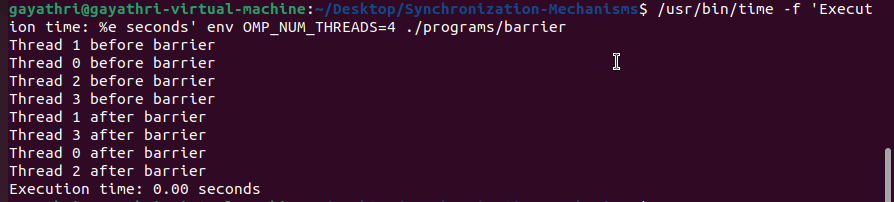
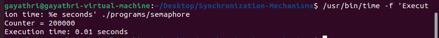
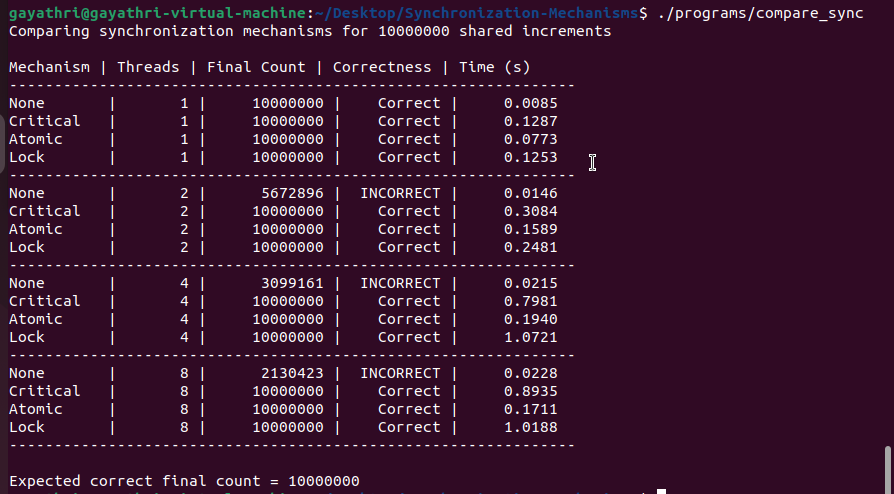

# Analyze Synchronization Mechanisms in Parallel Programs

## 1. Objective

To implement and study common synchronization mechanisms used in shared-memory parallel programs:

- Race Condition (Unsynchronized Access)
- Critical Section
- Atomic Operation
- Barrier Synchronization
- Semaphore
- OpenMP Lock

The experiment evaluates correctness, execution time, and scalability as the number of threads increases.

## 2. Software Requirements

| Software / Tool | Purpose |
|---|---|
| VMware Workstation | Virtualization |
| Ubuntu 22.04.5 LTS | Guest operating system |
| GCC 11.4.0 | C compiler |
| OpenMP | Parallel programming and synchronization |
| POSIX Threads | Thread management |
| Semaphore Library | Semaphore-based synchronization |
| Ubuntu Terminal | Compilation and execution |

## 3. Experimental Environment

- Operating System: Ubuntu 22.04.5 LTS
- Compiler: GCC 11.4.0
- OpenMP: Supported through GCC
- Virtual CPUs: 2
- VM Memory: 2 GB (initial configuration)
- Workload: 10,000,000 increments for counter experiments

**Note:** The experiment was performed using a VM with 2 virtual CPUs. Configurations using 4 and 8 threads involve oversubscription.

## 4. Synchronization Mechanisms

### 4.1 Race Condition

Multiple threads access and update a shared variable without synchronization. Since `counter++` involves reading, incrementing and writing, simultaneous updates can cause lost increments.

### 4.2 Critical Section

The OpenMP `#pragma omp critical` directive allows only one thread at a time to execute the protected block.

### 4.3 Atomic Operation

The OpenMP `#pragma omp atomic` directive protects a supported operation on a shared variable. It is suitable for simple updates such as incrementing a counter.

### 4.4 Barrier

The OpenMP `#pragma omp barrier` directive makes threads wait until all participating threads reach the synchronization point before proceeding.

### 4.5 Semaphore

A POSIX binary semaphore initialized to 1 controls access to a shared resource using `sem_wait()` and `sem_post()`.

### 4.6 OpenMP Lock

An OpenMP lock uses `omp_set_lock()` and `omp_unset_lock()` to provide explicit mutual exclusion.

## 5. Repository Structure

```text
Synchronization-Mechanisms/
│
├── programs/
│   ├── race.c
│   ├── critical.c
│   ├── atomic.c
│   ├── barrier.c
│   ├── semaphore.c
│   └── compare_sync.c
│
├── results/
│   ├── race-condition.md
│   ├── critical-section.md
│   ├── atomic-operation.md
│   ├── barrier-synchronization.md
│   ├── semaphore.md
│   └── comparison-benchmark.md
│
├── screenshots/
│   ├── race-condition.png
│   ├── critical-section.png
│   ├── atomic-operation.png
│   ├── barrier-synchronization.png
│   ├── semaphore.png
│   └── comparison-benchmark.png
│
├── .gitignore
└── README.md
```

## 6. Compilation and Execution

Run the following commands from the repository root directory.

### Program 1: Race Condition

```bash
gcc programs/race.c -fopenmp -o programs/race

OMP_NUM_THREADS=1 ./programs/race
OMP_NUM_THREADS=2 ./programs/race
```

### Program 2: Critical Section

```bash
gcc programs/critical.c -fopenmp -o programs/critical

OMP_NUM_THREADS=1 ./programs/critical
OMP_NUM_THREADS=2 ./programs/critical
```

### Program 3: Atomic Operation

```bash
gcc programs/atomic.c -fopenmp -o programs/atomic

OMP_NUM_THREADS=1 ./programs/atomic
OMP_NUM_THREADS=2 ./programs/atomic
```

### Program 4: Barrier Synchronization

```bash
gcc programs/barrier.c -fopenmp -o programs/barrier

OMP_NUM_THREADS=2 ./programs/barrier
OMP_NUM_THREADS=4 ./programs/barrier
OMP_NUM_THREADS=8 ./programs/barrier
```

### Program 5: Semaphore

```bash
gcc programs/semaphore.c -pthread -o programs/semaphore

./programs/semaphore
```

### Program 6: Comparison Benchmark

```bash
gcc programs/compare_sync.c -fopenmp -o programs/compare_sync

./programs/compare_sync
```

The comparison program evaluates None, Critical, Atomic and Lock mechanisms using 1, 2, 4 and 8 threads.

## 7. Experimental Results

### 7.1 Race Condition

| Threads | Final Counter | Expected Counter |
|---|---:|---:|
| 1 | 10,000,000 | 10,000,000 |
| 2 | 5,811,036 | 10,000,000 |
| 8 | 1,397,744 | 10,000,000 |

The multi-threaded executions demonstrated lost updates due to unsynchronized access.

### 7.2 Critical Section

| Threads | Final Counter | Execution Time |
|---|---:|---:|
| 1 | 10,000,000 | 0.16 s |
| 2 | 10,000,000 | 0.32 s |
| 8 | 10,000,000 | 0.79 s |

The critical section maintained correctness but introduced waiting and synchronization overhead.

### 7.3 Atomic Operation

| Threads | Final Counter | Execution Time |
|---|---:|---:|
| 1 | 10,000,000 | 0.10 s |
| 2 | 10,000,000 | 0.10 s |
| 8 | 10,000,000 | 0.16 s |

Atomic operations maintained correctness with lower observed execution time than the critical section.

### 7.4 Barrier Synchronization

Barrier synchronization was tested with 2, 4 and 8 threads.

**Latest observed execution: 4 threads**

All four threads printed their messages before the barrier before any thread printed its message after the barrier.

Execution time reported by `/usr/bin/time`: 0.00 seconds (rounded to two decimal places).

The order of individual thread messages varied between executions.

### 7.5 Semaphore

Two POSIX threads each performed 100,000 increments.

Expected counter: 200,000.

Latest observed execution:

```text
Counter = 200000
Execution time: 0.01 seconds
```

The binary semaphore ensured mutually exclusive access to the shared counter.

## 8. Comparison Benchmark

Workload: 10,000,000 shared increments.

Latest observed benchmark:

| Mechanism | Threads | Final Count | Correctness | Time (s) |
|---|---:|---:|---|---:|
| None | 1 | 10,000,000 | Correct | 0.0085 |
| Critical | 1 | 10,000,000 | Correct | 0.1287 |
| Atomic | 1 | 10,000,000 | Correct | 0.0773 |
| Lock | 1 | 10,000,000 | Correct | 0.1253 |
| None | 2 | 5,672,896 | Incorrect | 0.0146 |
| Critical | 2 | 10,000,000 | Correct | 0.3084 |
| Atomic | 2 | 10,000,000 | Correct | 0.1589 |
| Lock | 2 | 10,000,000 | Correct | 0.2481 |
| None | 4 | 3,099,161 | Incorrect | 0.0215 |
| Critical | 4 | 10,000,000 | Correct | 0.7981 |
| Atomic | 4 | 10,000,000 | Correct | 0.1940 |
| Lock | 4 | 10,000,000 | Correct | 1.0721 |
| None | 8 | 2,130,423 | Incorrect | 0.0228 |
| Critical | 8 | 10,000,000 | Correct | 0.8935 |
| Atomic | 8 | 10,000,000 | Correct | 0.1711 |
| Lock | 8 | 10,000,000 | Correct | 1.0188 |

Expected correct final count: **10,000,000**

## 9. Observations and Comparison

| Mechanism | Correctness | Observed Performance | Scalability |
|---|---|---|---|
| None | Unreliable with multiple threads | Fast but incorrect with multiple threads | Poor correctness |
| Critical | Correct | Higher synchronization overhead | Poor in this experiment |
| Atomic | Correct | Fastest among synchronized methods in the benchmark | Best observed performance |
| Lock | Correct | Higher synchronization overhead | Poor in this experiment |
| Barrier | Synchronizes execution phases | Waiting overhead | Depends on the slowest thread |
| Semaphore | Correct | Mutual-exclusion overhead | Depends on contention |

### Key Observations

1. Unsynchronized shared updates produced incorrect results with multiple threads.
2. Critical sections ensured correctness but increased execution time.
3. Atomic operations provided the best observed performance among the synchronized counter-update methods.
4. OpenMP locks ensured correctness but had higher overhead.
5. Barrier synchronization ensured that all threads reached the synchronization point before proceeding.
6. Semaphore synchronization maintained the expected counter.
7. Increasing the thread count did not improve performance on the available VM.

**Timing methodology:** The individual program execution times were measured using `/usr/bin/time`, which reports total process wall-clock time. The comparison benchmark measures execution time internally. These measurements use different timing scopes and should not be directly compared.

**Experimental limitation:** The benchmark timings represent individual observed runs on a virtual machine with 2 virtual CPUs. The 4- and 8-thread configurations were oversubscribed. Timings may vary across executions and hardware. Unsynchronized concurrent access to a shared counter in C constitutes a data race, so its behavior is not guaranteed.

## 10. Execution Screenshots

The following screenshots provide evidence of the program executions.

### 10.1 Race Condition



### 10.2 Critical Section



### 10.3 Atomic Operation



### 10.4 Barrier Synchronization



### 10.5 Semaphore



### 10.6 Comparison Benchmark



## 11. Conclusion

The experiment demonstrated the importance of synchronization mechanisms in shared-memory parallel programming.

Race conditions can cause lost updates when multiple threads access shared data without protection. Critical sections, atomic operations, locks and semaphores provide mechanisms to ensure correct access to shared resources. Barriers synchronize the execution phases of parallel programs.

In the latest comparison benchmark, atomic operations demonstrated the best performance among the tested synchronization mechanisms for simple counter updates. Critical sections and locks introduced higher synchronization overhead.

The experiment highlights the trade-off between correctness, execution time and scalability when selecting synchronization mechanisms.

## 12. Author

Analyze Synchronization Mechanisms in Parallel Programs.
